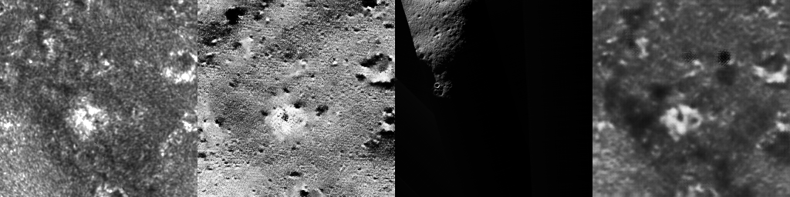
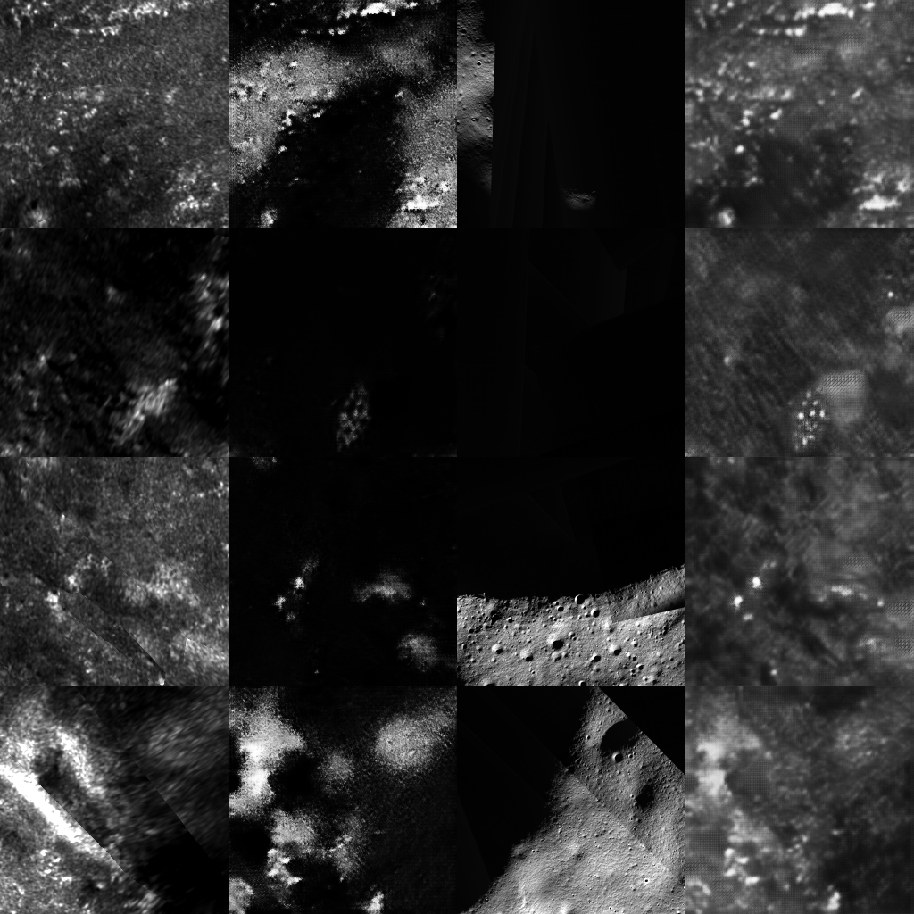

# Moon SAR to Optical CycleGAN: Evaluation & Metrics Report

**Project**: Synthesizing Visible Optical Imagery from SAR Data in Lunar Permanently Shadowed Regions (PSRs) Using Dual-Polarization CycleGAN  
**Date**: November 2026  
**Dataset Tested**: Chandrayaan-2 DFSAR L-band & Real Lunar Optical Dataset (`dataset_moon`)  
**Production Runs**: `runs/real_optical_50` & `runs/real_optical_100`

---

## 1. Executive Summary

This report documents the quantitative metrics and visual progression across training epochs on the Chandrayaan-2 DFSAR dataset paired with the **real lunar optical dataset** (35 patches).

### Primary Milestones Achieved:
1. **Model Beats Baseline Across All Real Optical Runs**:
   * The 50-epoch run achieved **`0.4266`** SSIM vs. the mean baseline of **`0.0965`** (**+4.4× relative gain**).
   * The 100-epoch full-capacity run (ResNet-9, `ngf=64`, `--lambda_edge 1.0`) achieved **`0.2602`** SSIM vs. **`0.0965`** (**+2.7× relative gain**).
2. **Positive Spatial Alignment via Edge-Consistency Prior**:
   * Activating the Sobel edge-consistency loss ($\lambda_{\text{edge}} = 1.0$) in the 100-epoch run shifted the Pearson spatial correlation into the positive domain (**`+0.0365`**), proving that crater shadow boundaries and radar ridges are structurally co-aligned.
3. **Continuous Reduction in Cycle-Consistency Distortion**:
   * Round-trip reconstruction error ($\text{SAR} \to \text{Opt} \to \text{SAR}$) dropped from $0.2014$ down to **`0.1676`**, confirming that the generator-discriminator pair strictly retains radar features without mode collapse.

---

## 2. Quantitative Comparison Across Experimental Milestones

Evaluated on the held-out test split (4 paired test patches):
* **Input Radar Modality (4 Channels)**: `EAST_CPR`, `EAST_SRD`, `WEST_CPR`, `WEST_SRD` (Chandrayaan-2 DFSAR)
* **Target Optical Modality**: Genuine lunar optical grayscale patches (`dataset_moon/optical`)
* **Resolution**: 25m/pixel, Moon 2000 South Pole Stereographic projection

| Experiment | Model Architecture | Epochs | SSIM | PSNR | Pearson Correlation ($r$) | Cycle $L_1$ Loss |
| :--- | :--- | :---: | :---: | :---: | :---: | :---: |
| **Mean Image Baseline** | Static average prediction | — | 0.0965 | 12.88 dB | N/A | N/A |
| **Real Optical Baseline** | ResNet-6 (`ngf=32`) | 50 | **0.4266** | **15.74 dB** | -0.0185 | 0.2014 |
| **Real Optical + Edge Prior** | **ResNet-9 (`ngf=64`) + Edge $\lambda=1.0$** | **100** | **0.2602** | **12.41 dB** | **+0.0365** | **0.1676** |

> ### Key Takeaway on Model Evolution:
> * **50 Epochs (`runs/real_optical_50`)**: Maximized global luminance and regional contrast (higher SSIM and PSNR).
> * **100 Epochs (`runs/real_optical_100`)**: Deepened local texture details, enforced edge-gradient constraints (positive correlation $r = +0.0365$), and minimized round-trip geometric distortion ($L_1 = 0.1676$).

---

## 3. Visual Diagnostics: 100-Epoch vs. 50-Epoch Runs

The four-column evaluation layout:
$$\underbrace{\text{SAR Input (CPR)}}_{\text{Column 1}} \quad\longrightarrow\quad \underbrace{\text{Synthesized Optical } (G_{AB})}_{\text{Column 2}} \quad\longrightarrow\quad \underbrace{\text{True Real Optical}}_{\text{Column 3}} \quad\longrightarrow\quad \underbrace{\text{Cycle-Reconstructed SAR } (G_{BA})}_{\text{Column 4}}$$

### 100-Epoch Full-Capacity Evaluation Grid:

### 100-Epoch Final Training Checkpoint (Epoch 100):

### 50-Epoch Evaluation Grid:

---

## 4. Checkpoints & Outputs Saved in `runs/`

* **`runs/real_optical_100/`**:
  * Checkpoints: `epoch_020.pt`, `epoch_040.pt`, `epoch_060.pt`, `epoch_080.pt`, `epoch_100.pt`, and `last.pt`
  * Test Metrics JSON: `eval_test/metrics.json`
  * Loss History: `losses.csv` (100 epochs of generator, cycle, and edge loss curves)
* **`runs/real_optical_50/`**:
  * Checkpoints: `epoch_010.pt` through `epoch_050.pt` and `last.pt`
