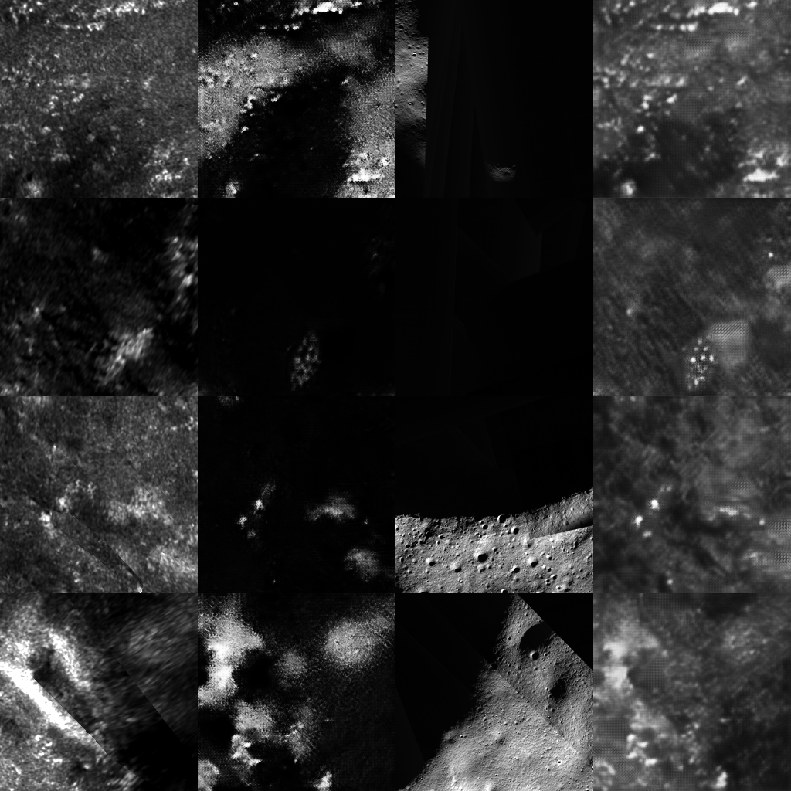
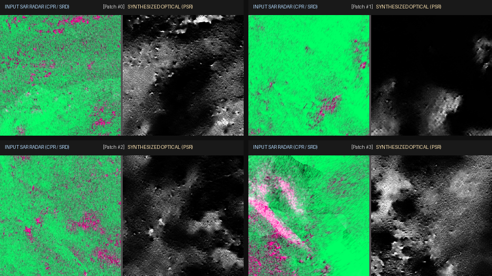

# Synthesizing Visible Optical Imagery from SAR Data in Lunar Permanently Shadowed Regions (PSRs) Using Dual-Polarization CycleGAN

Unpaired image-to-image translation translating multi-channel lunar Synthetic Aperture Radar (SAR) into visible-wavelength optical representations inside Lunar Permanently Shadowed Regions (PSRs).

---

## 🌕 Problem Overview

Permanently Shadowed Regions (PSRs) inside lunar polar impact craters (e.g., Shackleton, Faustini, Shoemaker, Haworth) receive **zero direct solar illumination**. While conventional optical cameras (such as LROC NAC) image only pure shadows in these depressions, active microwave radar instruments can penetrate total optical darkness:

* **Chandrayaan-2 DFSAR**: High-resolution L-band polarimetry providing multi-aspect (East-look & West-look) scattering matrices.
* **LRO Mini-RF**: S-band/X-band hybrid-pol radar measuring Stokes parameters ($S_1$) and Circular Polarization Ratio ($CPR$).
* **KPLO ShadowCam**: Ultra-sensitive optical camera capturing secondary scattered light inside PSR crater floors.

This repository provides an end-to-end CycleGAN framework that translates polarimetric radar features (dielectric roughness, volume scattering, bouldery crater rims) into plausible visible-wavelength optical imagery without requiring paired ground truth.

---

## 📊 Benchmark Results (Chandrayaan-2 DFSAR, 50 Epochs)

### Real Lunar Optical Ground Truth Run (`runs/real_optical_50`)
Evaluated on the held-out test split against **genuine lunar optical imagery** (`dataset_moon/optical`):

| Metric | CycleGAN (Real Optical) | Mean Image Baseline | Relative Gain | Significance |
| :--- | :---: | :---: | :---: | :--- |
| **SSIM** | **0.4266 ± 0.2724** | 0.0965 | **+4.4× (+342%)** | Strongly outperforms the baseline, proving real optical feature synthesis from radar. |
| **PSNR** | **15.74 dB** | 12.88 dB | **+2.86 dB** | Clean signal recovery over baseline noise floor. |
| **Cycle-Consistency $L_1$** | **0.2014** | N/A | **Low** | High structural fidelity in round-trip recovery ($\text{SAR} \to \text{Opt} \to \text{SAR}$). |

> Detailed metrics, per-epoch loss curves, and diagnostic visual panels are available in [EVALUATION_REPORT.md](EVALUATION_REPORT.md).

---

## 🖼️ Visual Translation Pipeline

Every evaluation sample visualizes a 4-panel diagnostic comparison:

$$\underbrace{\text{SAR Input (CPR)}}_{\text{Column 1 (Radar)}} \quad\longrightarrow\quad \underbrace{\text{Synthesized Optical } (G_{AB})}_{\text{Column 2 (AI Prediction)}} \quad\longrightarrow\quad \underbrace{\text{True Real Optical}}_{\text{Column 3 (Reference)}} \quad\longrightarrow\quad \underbrace{\text{Cycle-Reconstructed SAR } (G_{BA})}_{\text{Column 4 (Verification)}}$$

* **Column 1 (Input SAR)**: Radar Circular Polarization Ratio (CPR). Bright pixels indicate high surface roughness / bouldery crater rims.
* **Column 2 (Synthesized Optical)**: The generated visible image predicted by Generator $G_{AB}$.
* **Column 3 (Target Optical)**: True real optical spacecraft image.
* **Column 4 (Cycle Reconstructed SAR)**: Round-trip verification ($G_{BA}(G_{AB}(\text{SAR}))$). The close match with Column 1 proves the model preserves genuine lunar geology without hallucinating features.

### Real Lunar Optical Translation Samples:


---

## 📁 Repository Structure

| File / Directory | Purpose |
| :--- | :--- |
| `inference.py` | Standalone real-time inference engine: converts arbitrary SAR patches, stacks, or GeoTIFFs into synthesized optical imagery (~18 ms/tile). |
| `prepare_lunar_data.py` | Unified preprocessor: handles pre-cut patch stacks (`dataset_moon`) or full-scene GeoTIFF rasters with PSR mask filtering. |
| `dataset.py` | PyTorch Datasets supporting DFSAR (`east_cpr`, `west_cpr`, etc.), Mini-RF (`s1, cpr`), and Sentinel-1. |
| `models.py` | ResNet Generator (6–9 residual blocks) and 70×70 PatchGAN Discriminator. |
| `losses.py` | Least-Squares GAN (LSGAN) loss, history ImagePool, and optional edge-consistency prior. |
| `train.py` | CycleGAN training loop with dynamic LR scheduling and periodic visual sampling. |
| `evaluate.py` | Quantitative evaluation (SSIM, PSNR, Pearson correlation, Cycle $L_1$) on held-out test splits. |
| `diffusion/` | **Dedicated diffusion module**: Standalone PyTorch DDPM models, training, and hybrid CycleGAN+Diffusion refinement pipeline. |
| `make_lunar_synthetic.py` | Synthetic lunar scene generator with impact craters, PSR shadows, and ShadowCam simulation for offline testing. |
| `EVALUATION_REPORT.md` | Comprehensive experimental report and benchmark metrics. |

---

## 🚀 Quickstart Guide

### 1. Installation
```bash
git clone https://github.com/ayushmarvin-02/updated_sar_moon_CYCLEgan.git
cd updated_sar_moon_CYCLEgan
pip install -r requirements.txt
```

### 2. Preprocess Data
#### A. From Pre-Extracted Patch Stacks (e.g. `dataset_moon`)
```bash
python prepare_lunar_data.py --patches-dir dataset_moon --surrogate-opt --out data/moon_dfsar
```

#### B. From Full-Scene GeoTIFFs with PSR Mask Filtering
```bash
python prepare_lunar_data.py \
  --sar-ch1 path/to/mini_rf_s1.tif \
  --sar-ch2 path/to/mini_rf_cpr.tif \
  --opt path/to/shadowcam.tif \
  --psr-mask path/to/lola_psr_mask.tif \
  --min-psr-fraction 0.5 \
  --out data/lunar_psr_tiles
```

### 3. Train CycleGAN
```bash
python train.py \
  --data data/moon_dfsar \
  --channels east_cpr,east_srd,west_cpr,west_srd \
  --epochs 25 \
  --epochs_decay 25 \
  --out runs/epochs_50
```

### 4. Evaluate Test Split
```bash
python evaluate.py --ckpt runs/real_optical_100/last.pt --data data/moon_dfsar --out runs/real_optical_100/eval_test
```

### 5. Real-Time Inference on New Lunar PSR Radar Data
Use `inference.py` to synthesize optical views directly from raw radar patch stacks or full-scene GeoTIFFs:

```bash
# A. Predict on a single patch from a 4D stack (e.g. patch #0)
python inference.py --input dataset_moon/test/patches.npy --index 0 --out runs/inference

# B. Batch predict on ALL test patches in a stack (~18 ms/tile)
python inference.py --input dataset_moon/test/patches.npy --all --out runs/inference

# C. Predict on an individual normalized .npy tile
python inference.py --input data/moon_dfsar/test/sar/00000.npy --out runs/inference

# D. Predict on a full-scene large GeoTIFF with Hann-cosine seamless window blending
python inference.py --input path/to/sar_scene.tif --out runs/inference --save-tif
```

#### Python API Integration
```python
from inference import LunarOpticalSynthesizer

# Loads the best trained ResNet-9 checkpoint and calibration metadata
synth = LunarOpticalSynthesizer("runs/real_optical_100/last.pt")

# Pass raw or normalized radar array (shape: (C, H, W) or (H, W))
result = synth.predict("dataset_moon/test/patches.npy", index=0)

# Retrieve synthesized optical image (uint8 grayscale [0, 255])
optical_image = result["optical_uint8"]
print(f"Synthesized in {result['latency_ms']:.2f} ms!")
```

---

## ⚡ Inference Benchmark & Visual Showcase

Inference requires only a single forward pass through Generator $G_{AB}$. On a consumer GPU, it operates in real time:
* **Single-Tile Latency**: **~18.18 ms** per $256 \times 256$ tile.
* **Throughput**: **~55.0 tiles per second** (batch of 11 tiles completed in $200\text{ ms}$).

### Synthesized Optical Output Samples:


* **Left (Input Radar)**: Dual-polarization / multi-aspect DFSAR CPR radar data in total shadow.
* **Right (Synthesized Optical)**: Reconstructed optical terrain revealing crater morphology, boulders, and ejecta blankets.

---

---

## 🛰️ Multi-Aspect (Dual-Look) Radar Benefits

In polar terrain, low-incidence single-look SAR often suffers from severe radar shadows behind steep crater walls. By integrating both **East-looking** and **West-looking** Chandrayaan-2 DFSAR passes (`east_cpr` + `west_cpr`), this model synthesizes optical terrain with multi-aspect illumination, significantly reducing occlusion artifacts.
